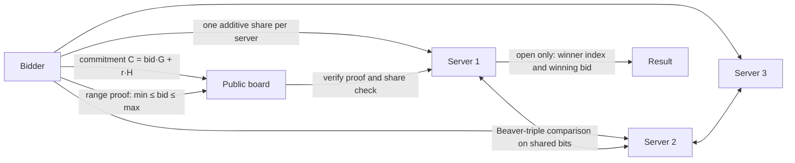

<div align="center">

# Secure Sealed-Bid Auction

**Bidders prove their bid is in range without revealing it. Three servers find the highest bid without ever seeing one.**
Only the winner and the winning price come out.

[](https://github.com/Abdelrahmanshaheen1/Secure-Auction-Pedersen-Commitments/actions/workflows/tests.yml)


[](LICENSE)

</div>

## At a glance

| | |
|---|---|
| **What** | Pedersen commitments + zero-knowledge range proof + 3-server MPC, written from scratch in plain Python |
| **Curve** | secp256k1 (checked against OpenSSL in the tests) |
| **Output** | The winner and the winning price. No losing bid, and no difference between bids, is ever opened |
| **Try it** | `python auction.py` (no packages needed) |
| **Tests** | 110, including forged proofs and cheating bidders, mutation-tested |
| **Honest scope** | A one-process simulation of the protocol, not a deployed system. See [Security properties, and their limits](#security-properties-and-their-limits) |

```text
📝 Registering Bidder 1 with bid 10...
   ✗ Invalid bid: Bid 10 is not in range [100, 1000]

📝 Registering Bidder 2 with bid 999...
   ✓ Commitment 032ba33ab19afbf764068f12...
   ✓ Range proof generated (20 bit commitments)
   ✓ Proof verified, shares match the commitment
   ✓ Bid split into 3 shares per bit
   ...
🏆 Winner: Bidder 2
💰 Winning Bid: 999
🔐 Opened during the run: 11 output values (winner and winning bid) and 120 uniformly random Beaver values.
   No losing bid, and no difference between bids, was revealed.
```

<sub>Excerpt of the real output of `python auction.py` (third example auction, lightly shortened).</sub>

## Contents

[Architecture](#architecture) · [How it works](#how-it-works) · [Run it](#run-it) · [Security properties](#security-properties-and-their-limits) · [Tests](#tests) · [What changed](#what-changed) · [Repository layout](#repository-layout) · [Team and credits](#team-and-credits) · [License](#license)

## Architecture



The four building blocks, each a separate module:

| Piece | File | What it does |
|---|---|---|
| Elliptic-curve arithmetic | `ec.py` | secp256k1 points, scalar multiplication, hash-to-curve |
| Pedersen commitments | `commitments.py` | `C = bid·G + r·H`; hiding and binding, with `H` derived from a public seed |
| Zero-knowledge range proof | `zkproofs.py` | proves `min ≤ bid ≤ max` for a commitment, without revealing the bid |
| Secret sharing + MPC | `secret_sharing.py`, `mpc.py` | 3-server additive sharing, Beaver-triple multiplication, secure comparison and maximum |
| The protocol | `auction.py`, `auction_enhanced.py` | ties it together; the enhanced file adds timings and an interactive mode |

> **History.** The original course submission was a 3-person team project. That version used `SHA256(bid:randomness)` where the README said "Pedersen", its range-proof verifier never checked the proof's response (so a proof could be forged), and its comparison step revealed the difference between bids, which exposes every losing bid once the winning bid is known. The cryptographic core was rewritten afterwards to fix all three; see [What changed](#what-changed).

## How it works

1. **Commit.** A bidder publishes `C = bid·G + r·H` on secp256k1. `H` is the hash-to-curve of a public string, so nobody knows `log_G(H)`, which is what makes the commitment binding. The random `r` makes it hiding.
2. **Prove the range.** To show `0 ≤ x < 2ⁿ` for a committed `x`, the bidder commits to each bit, `Cᵢ = bᵢ·G + rᵢ·H`, so that `Σ 2ⁱ·Cᵢ` equals the commitment to `x` (the verifier checks that equation), and proves each `Cᵢ` holds a 0 or a 1 with a Fiat-Shamir OR-proof (the false branch is simulated, so the verifier cannot tell which branch is real). Doing this once for `bid − min` and once for `max − bid`, both derived from the same `C`, proves `min ≤ bid ≤ max`. The proof is about 3 KB for a range of width 900.
3. **Share.** The bidder splits every bit of `bid − min` (and the randomness of its bit commitment) into 3 additive shares, one per server. Each server can publish `bᵢⱼ·G + rᵢⱼ·H` for its own shares; the sum over servers must equal the proof's `Cᵢ`. That ties the shared bits to the proven commitment, so a bidder cannot commit to one bid and share another.
4. **Compare.** The servers compute the maximum on the shared bits. Linear steps are local. Each multiplication uses a Beaver triple: the servers open `d = x − a` and `e = y − b`, which are uniformly random because `a` and `b` are one-time masks. A comparison scans the bits from the lowest, where bits differ the number with the 1 is bigger, and an oblivious select keeps the running maximum and its index secret. At the end only the winner's index and the winning bid's bits are opened.

Bids that fail the proof or the share check are rejected before they take part. Ties go to the earliest bidder.

## Run it

~~~bash
python auction.py             # the three example auctions
python auction_enhanced.py    # same, with detailed output and an optional interactive mode
~~~

No packages are needed to run the auction. The tests need two:

~~~bash
pip install -r requirements.txt
pytest -q                     # 110 tests, about 20 seconds
~~~

Example results (also what the notebook shows):

| Scenario | Input bids (range 100–1000) | Result |
|---|---|---|
| Normal auction | [150, 920, 600] | Bidder 2 wins at 920 |
| Tie | [350, 350, 100, 300] | Bidder 1 wins at 350 (first bidder wins ties) |
| Invalid bids mixed in | [10, 999, 300, 700, 2000] | 10 and 2000 rejected; Bidder 2 wins at 999 |

Cost on a laptop, pure Python: about 140 ms to generate a range proof, about 250 ms for the servers to verify it and check the shares, and a few milliseconds for the secure maximum (10 bidders: 270 Beaver multiplications).

## Security properties, and their limits

What holds, and under which assumptions:

- **Bid secrecy.** Commitments are information-theoretically hiding. During the computation the servers see only uniformly random masked values and the final output, so no losing bid and no difference between bids is revealed. Learning anything about a bid beyond the output requires all 3 servers to collude (semi-honest model).
- **Valid bids only.** An out-of-range bid has no valid proof; forging one means breaking the discrete-log assumption on secp256k1 (and the Fiat-Shamir hash behaving like a random oracle). The verifier enforces its own range rather than trusting the range written in the proof.
- **Binding.** A bidder cannot change the bid after committing (discrete log), cannot commit to one bid and share another (the share check), and cannot replay someone else's submission under another bidder id (the id is hashed into the proof).

What this is not:

- It is a **simulation in one process**. The 3 servers and the bidders are objects, there is no network, no authentication of bidders, and no payment or non-repudiation step.
- The servers are assumed **semi-honest**. A server that deviates from the protocol is not detected (no MACs or verifiable shares).
- The **Beaver triples come from a trusted dealer** in `mpc.py`. A real deployment would generate them in an offline phase (oblivious transfer or homomorphic encryption).
- The proof binds to the bidder id only. A real deployment should also hash in a fresh auction id so submissions cannot be reused across auctions.
- The elliptic-curve code is plain Python integers, **not constant-time**. It is checked against OpenSSL (via the `cryptography` package) in `tests/test_ec.py`, but it is not meant for protecting real secrets.
- The range proof is linear in the number of bits (not logarithmic like Bulletproofs), which is fine for ranges like this one.
- The winning bid is public, so every losing bid is known to be at most that.

## Tests

`tests/` covers each layer, including attacks, not just the happy path:

- **ec**: scalar multiplication matches OpenSSL on fixed and random scalars; group order, addition laws, encoding.
- **commitments**: opening, hiding, binding, homomorphism, deterministic public `H`.
- **zkproofs**: accepted at the range boundaries and for tiny and power-of-two ranges; the honest prover refuses out-of-range bids; **forged proofs** for out-of-range bids (built by running the real prover machinery on a wrong value) are rejected; the old forgeable proof format is rejected; tampering with any part of a proof, a wrong commitment, a wrong bidder context, a wider range, and malformed input (which must return `False`, never raise).
- **MPC**: Beaver multiplication; the secure comparison is checked on **all 256 pairs of 4-bit numbers** and on random 10-bit numbers; maximum with ties; and a test that nothing but masked values and the result is ever opened, and that no difference between bids appears among them.
- **auction**: the three scenarios above, boundary bids, random auctions against Python's `max`, cheating bidders (forged proof, sharing a different bid than the one committed, replay under another id, proof for a wider range, duplicate ids, malformed submissions), and that no plaintext bid is stored.

The checks were also mutation-tested: removing the bit-sum check, the bit proofs, the context binding, the share check, the Beaver `d·e` term or the XOR step makes tests fail. GitHub Actions runs the suite on every push.

## What changed

| Before | Now |
|---|---|
| `commit_bid` = `SHA256("bid:randomness")`; the generators `G` and `H` were the strings `"G"` and `"H"` | Real Pedersen commitments on secp256k1; `H` from hash-to-curve of a public seed |
| Range-proof verifier recomputed a hash of public values and never used the response, so anyone could forge a proof; the range itself was never verified | Bit-decomposition range proof with OR-proofs; the verifier checks the bit sum, every bit proof, and its own range |
| The servers opened `bid_i − bid_max` at each comparison; with the winning bid, every other bid follows (for [150, 920, 600]: differences 770 and −320, so 920 gives 150 and 600), contradicting "losing bids are never revealed" | Comparison on shared bits with Beaver triples; only the winner and the winning bid are opened |
| Bidders' plaintext bids and randomness were stored inside the auction object | Servers keep only commitments, proofs and shares |
| Share arithmetic modulo a 61-bit prime, unrelated to the commitments | Shares modulo the secp256k1 group order, so shares of the bits line up with the bit commitments |

## Repository layout

```text
.
├── ec.py                       # secp256k1 arithmetic, hash-to-curve
├── commitments.py              # Pedersen commitments
├── zkproofs.py                 # bit-decomposition range proof, Fiat-Shamir OR-proofs
├── secret_sharing.py           # 3-server additive sharing
├── mpc.py                      # Beaver triples, secure comparison and maximum
├── auction.py                  # the protocol and the three example auctions
├── auction_enhanced.py         # same, with timings and an interactive mode
├── Secure_Auction_Project.ipynb  # notebook walkthrough
├── tests/                      # one test module per layer
├── requirements.txt            # test-only dependencies
└── .github/workflows/tests.yml # CI
```

## Team and credits

The original coursework was done by a team of three. This repository holds the version in which the cryptographic core was later rewritten (commitments, range proof, MPC comparison) and covered by tests; the history table above lists what changed and why.

## License

[MIT](LICENSE) © 2026 Abdelrahman Shaheen
